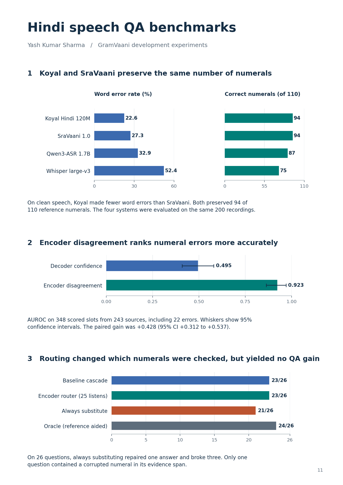

Hindi speech QA and numeral reliability
======================================

Yash Kumar Sharma

On the clean GramVaani benchmark, Koyal and SraVaani each preserved 94 of 110 numerals even though Koyal had the lower word error rate. That discrepancy led me to test whether Koyal's internal representations could identify a misheard number before it reached the answer model.

At the frozen threshold, the encoder score flagged 19 of 22 reference-labelled errors and 55 correct numerals. In the 26-question pilot, always substituting a second recognizer's value repaired one answer and introduced three errors. Only one question had a corrupted numeral in its evidence span.

The baseline averages NeMo's decoder token-confidence scores over the emitted numeral span and evaluates that particular measure of confidence. The numeral results illustrate a `known limitation of WER <https://www.isca-archive.org/interspeech_2021/kim21e_interspeech.html>`_: recognizers with equal numeral accuracy differed in how often they substituted a value or omitted it.

Reproducing the measurements
----------------------------

Run the following from the repository root with Python and NumPy::

    python verify_submission.py
    python numeral-evidence/replay/replay_all.py

The six tables replay from the packaged records. To redraw the figure, install Matplotlib and run python figures/plot_benchmarks.py. README.txt contains the full instructions for reproducing the FLEURS Hindi speech QA evaluation.
